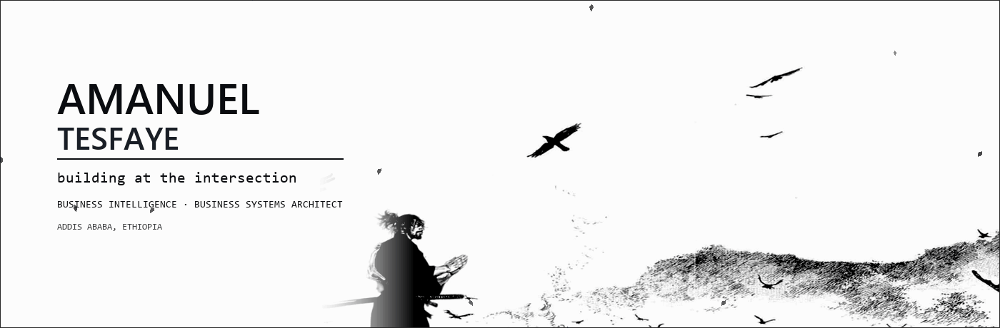

  

I bridge **Business Administration** (American College of Technology) and **Full Stack Systems Engineering** (Addis Ababa University) based in Addis Ababa, Ethiopia.

I approach software from the balance sheet and workflow perspective: architecting custom enterprise platforms, quantitative financial engines, and autonomous AI systems that eliminate operational friction and solve real unit economics.

---

### What I Do

- **Enterprise Systems & ERP Architecture** - Custom enterprise platforms, inventory engines, and commercial management software built around real-world unit economics and operational bottlenecks.
- **Autonomous AI & Operational Agents** - Persistent digital allies, headless daemons, and automated agent pipelines that eliminate administrative overhead.
- **Open-Source Systems & Telemetry** - Active contributor submitting targeted fixes and telemetry improvements for production platforms including **Twenty**, **Langfuse**, and **Cal.com**.
- **Financial Engineering & Market Technology** - Quantitative market structure models, algorithmic execution, and Pine Script v6 indicators designed for capital risk management.
- **Biomechanical & Embedded Hardware** - Code that interfaces with physical hardware: computer-integrated prosthetics, skeletal motion capture, and embedded microcontroller drivers.
- **Commercial UI & Product Architecture** - Workflow-driven interfaces in Figma designed to cut user error, paired with functional 3D product models in Blender.

---

### Languages & Core Stack

  
  
  
  
  
  

  
  
  
  
  
  

---

### GitHub Telemetry

  
  

  

---

### Honors & Verified Credentials

  
  &nbsp;
  
  &nbsp;
  

  
  &nbsp;
  
  &nbsp;
  

---

  <em>"Technology becomes powerful when business thinking and engineering precision work together."</em>

  ↻ daily sync - November 20, 2026

