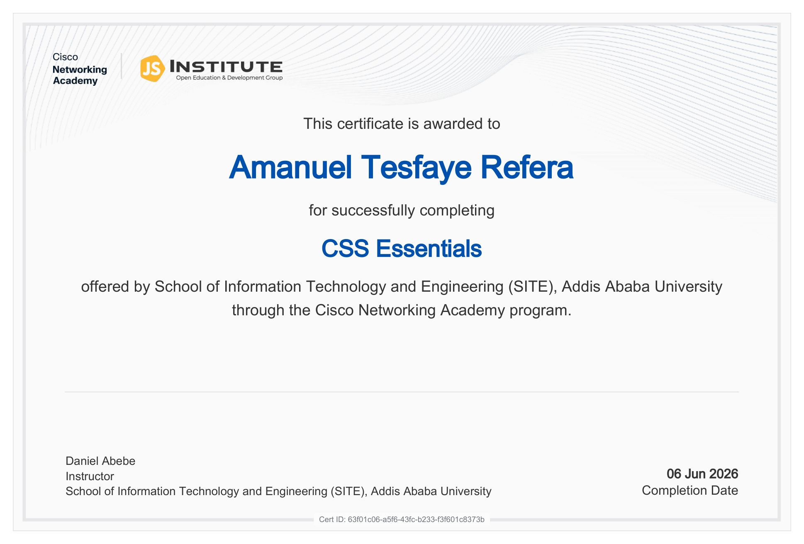
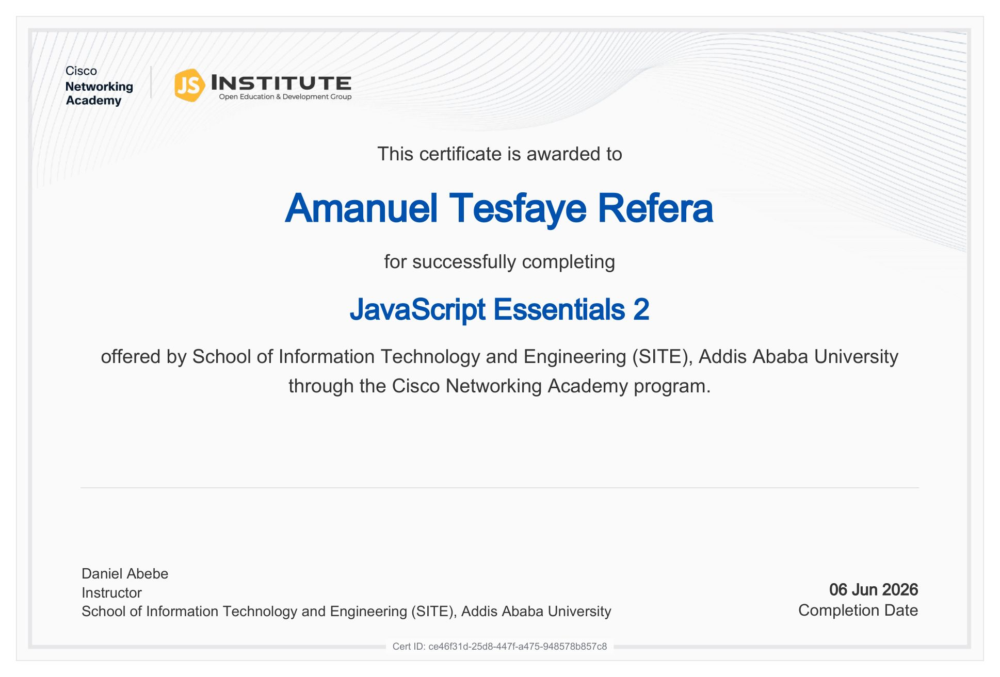

  

I bridge **Business Administration** (American College of Technology) and **Full Stack Systems Engineering** (Addis Ababa University) based in Addis Ababa, Ethiopia. 

I approach software from the balance sheet and workflow perspective: architecting custom ERPs, quantitative financial tools, and autonomous agent systems that eliminate operational friction and solve real unit economics.

---

### What I Do

- **Business Systems & ERP Architecture** - Custom enterprise platforms, inventory engines, and commercial management software built around actual unit economics and operational bottlenecks
- **Financial Engineering & Market Technology** - Quantitative market structure models, algorithmic execution, and Pine Script v6 indicators designed for capital risk management
- **Autonomous AI & Operational Agents** - Persistent digital allies, headless daemons, and automated agent pipelines that strip out administrative overhead
- **Full-Stack Systems Architecture** - Complete web platforms from database schema to user interaction, built to handle real business operations without failing
- **Biomechanical & Embedded Hardware** - Code that interfaces with the physical world: computer-integrated prosthetics, skeletal motion capture, and embedded controllers
- **Commercial UI & Product Design** - Workflow-driven interfaces in Figma designed to cut user error, paired with functional 3D product models in Blender

---

### Languages & Tools

**Software Development**

  
  
  
  
  
  
  
  

**Financial Market Technology**

  

**Database & Tools**

  
  
  

**Engineering & Hardware**

  
  
  

**Design & Modeling**

  
  

---

### Achievements

  <table>
    <tr>
      <td align="center">
         
        <b>INSA Cyber Talent</b> 
        Program Graduate
      </td>
      <td align="center">
         
        <b>2nd Place</b> 
        National Science Fair
      </td>
      <td align="center">
         
        <b>Computer-Integrated Prosthesis</b> 
        Built & Tested
      </td>
      <td align="center">
         
        <b>Business Intelligence</b> 
        Certified
      </td>
    </tr>
    <tr>
      <td align="center">
         
        <b>AI Agent Systems</b> 
        Designed & Deployed
      </td>
      <td align="center">
         
        <b>5+ Science Fair Certifications</b> 
        High School Projects & Awards
      </td>
      <td align="center">
         
        <b>Cisco Networking Academy</b> 
        HTML, CSS, JS Essentials
      </td>
    </tr>
  </table>

---

### GitHub Stats

  
  

  

---

### Certifications

  <table>
    <tr>
      <td align="center">
         
        <b>HTML Essentials</b> 
        
      </td>
      <td align="center">
         
        <b>CSS Essentials</b> 
        
      </td>
    </tr>
    <tr>
      <td align="center">
         
        <b>JavaScript Essentials 1</b> 
        
      </td>
      <td align="center">
         
        <b>JavaScript Essentials 2</b> 
        
      </td>
    </tr>
  </table>

---

  <em>"Technology becomes powerful when business thinking and engineering precision work together."</em>

---

↻ daily sync - November 20, 2026

